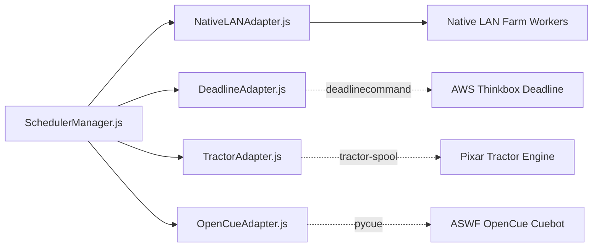

# OpenComp — Studio Pipeline, Interchange Formats & Distributed Rendering Architecture

## Table of Contents
1. [Pipeline Philosophy & System Architecture](#1-pipeline-philosophy--system-architecture)
2. [PipelineTokens & Path Resolution Engine](#2-pipelinetokens--path-resolution-engine)
   - [2.1 Dynamic Token Syntax & Variable Expansion](#21-dynamic-token-syntax--variable-expansion)
   - [2.2 Standard Supported Production Tokens](#22-standard-supported-production-tokens)
   - [2.3 Cross-Platform Path Mapping (Windows UNC / Linux POSIX)](#23-cross-platform-path-mapping-windows-unc--linux-posix)
3. [Image & Scene Interchange Subsystems](#3-image--scene-interchange-subsystems)
   - [3.1 OpenEXR Multi-Part, Multi-Channel & Lossy DWAA/DWAB](#31-openexr-multi-part-multi-channel--lossy-dwaadwab)
   - [3.2 OpenUSD (.usda/.usdc) & Alembic (.abc) Scene Exchange](#32-openusd-usdausdc--alembic-abc-scene-exchange)
   - [3.3 Bidirectional Foundry Nuke (.nk) Translation Subsystem](#33-bidirectional-foundry-nuke-nk-translation-subsystem)
4. [OpenFX 1.4 Plugin Host & Dynamic C-ABI Bridge](#4-openfx-14-plugin-host--dynamic-c-abi-bridge)
   - [4.1 Architecture & Process Isolation](#41-architecture--process-isolation)
   - [4.2 Supported OFX Suites & Parameter Mapping](#42-supported-ofx-suites--parameter-mapping)
5. [Headless CLI Batch Renderer (opencomp-render)](#5-headless-cli-batch-renderer-opencomp-render)
   - [5.1 CLI Syntax, Arguments & Execution Flags](#51-cli-syntax-arguments--execution-flags)
   - [5.2 Headless Frame Evaluation & Buffer Output](#52-headless-frame-evaluation--buffer-output)
6. [Native LAN Render Farm Architecture](#6-native-lan-render-farm-architecture)
   - [6.1 LANDispatcher & Network Protocol](#61-landispatcher--network-protocol)
   - [6.2 Worker Registration, Heartbeats & Auto-Reassignment](#62-worker-registration-heartbeats--auto-reassignment)
   - [6.3 Task State Machine & Corrupt Frame Recovery](#63-task-state-machine--corrupt-frame-recovery)
7. [Studio Multi-Scheduler Integration](#7-studio-multi-scheduler-integration)
   - [7.1 AWS Thinkbox Deadline Manifest Synthesis (.job)](#71-aws-thinkbox-deadline-manifest-synthesis-job)
   - [7.2 Pixar Tractor Manifest Synthesis (.alfred)](#72-pixar-tractor-manifest-synthesis-alfred)
   - [7.3 ASWF OpenCue Manifest Synthesis (.outline)](#73-aswf-opencue-manifest-synthesis-outline)
8. [Air-Gap Studio Deployment Runbook](#8-air-gap-studio-deployment-runbook)

---

## 1. Overview & Integration Philosophy

OpenComp is designed from first principles for direct, low-friction integration into enterprise visual effects, feature film, and episodic television studio pipelines.

### Key Integration Tenets:
1. **100% Air-Gapped Compliance**: Binds exclusively to the loopback interface (`127.0.0.1:8080`) with zero external network phone-home calls, analytics beacons, or remote font/asset requests.
2. **Cross-Platform Path Parity**: Automatic bidirectional translation between Windows UNC shares (`\\server\share\`) and Linux POSIX NFS mount points (`/mnt/share/`).
3. **Headless Lights-Out Execution**: Batch rendering CLI and distributed worker daemons execute identically across Linux render nodes and Windows workstations without GUI or display server requirements.
4. **Subprocess Isolation**: External C-ABI components (OpenFX, USD, Alembic) operate inside isolated child processes to contain native segfaults and protect host application state.

---

## 2. PipelineTokens & Path Resolution Engine

The `PipelineTokens` engine ([src/core/PipelineTokens.js](file:///c:/Users/rajeshn/Desktop/Rajesh/OpenComp/src/core/PipelineTokens.js)) standardizes file sequence paths, environment expansion, and cross-platform network mappings.

### 2.1 Token Syntax & Replacement Pipeline
The engine evaluates dynamic strings through a six-stage hierarchical resolution pipeline:

```
Source Path:  "${SHOW}/${SHOT}/v${VERSION:03d}/comp.####.exr"
      │
      ▼  Stage 1: Stash Escape Sentinels (\${...}, \####, \%04d)
      ▼  Stage 2: Expand Frame Pattern Formatting (#### -> "1042")
      ▼  Stage 3: Expand Bracketed Tokens (${SHOW} -> "vfx_show", ${VERSION:03d} -> "002")
      ▼  Stage 4: Expand Non-Bracketed Tokens ($SHOT -> "sh010")
      ▼  Stage 5: Expand Simple Bracket Tokens ({USER} -> "artist")
      ▼  Stage 6: Restore Escaped Sentinels
      │
Resolved Path: "vfx_show/sh010/v002/comp.1042.exr"
```

### 2.2 Standard Supported Tokens
| Token | Description | Example Replacement |
|---|---|---|
| `${SHOW}` / `$SHOW` | Active show or project identifier | `avatar3`, `vfx_core` |
| `${SHOT}` / `$SHOT` | Shot code | `sh010`, `sq020_sh040` |
| `${SEQ}` / `$SEQ` | Sequence identifier | `sq020`, `intro` |
| `${VERSION}` / `${VERSION:03d}` | Pipeline version integer with optional zero-padding | `2` $\to$ `002` |
| `${USER}` / `$USER` | Current artist username | `jdoe`, `pipeline_bot` |
| `${YYYY}`, `${MM}`, `${DD}` | Current calendar date components | `2026`, `11`, `16` |
| `####` | 4-digit zero-padded frame number | `1001` |
| `%04d`, `%d` | Standard printf-style frame formatters | `1001` |
| `@@@@` | Houdini-style frame padding | `1001` |

### 2.3 Cross-Platform Path Translation (`mapPath`)
OpenComp translates paths across hybrid operating systems via configured mapping rules:
- **Windows UNC $\longleftrightarrow$ Linux NFS**:
  ```
  \\studio-storage\projects\vfx  <===>  /mnt/storage/projects/vfx
  ```
- **Windows Drive Letters $\longleftrightarrow$ Linux NFS**:
  ```
  P:\projects\vfx                <===>  /mnt/projects/vfx
  ```
- **Path Normalization**: Windows targets receive normalized backslashes (`\`); Linux targets receive forward slashes (`/`). Relative paths remain relative.

---

## 3. Headless Batch Rendering CLI (`opencomp-render`)

OpenComp provides a dedicated command-line batch renderer located at `bin/opencomp-render.mjs` (and wrapper `bin/opencomp-render`):

### 3.1 Invocation Syntax
```bash
node bin/opencomp-render.mjs -p <project-path> [options]
```

### 3.2 CLI Parameters & Options
| Flag | Long Form | Type | Description |
|---|---|---|---|
| `-p` | `--project` | `String` | Path to `.opencomp` or legacy script `.nk` project file (Required) |
| `-w` | `--write` | `String` | Specific `Write` node name to render (Default: all Write nodes) |
| `-r` | `--range` | `String` | Frame range string (e.g. `1-100`, `1001-1050x2`, `1,5,10-20`) |
| `-t` | `--threads` | `Integer`| CPU thread count for software rasterization (Default: OS CPU cores) |
| `-v` | `--verbose` | `Flag` | Output frame execution timings, memory telemetry, and tile chunking |
| `-c` | `--continue`| `Flag` | Continue rendering subsequent frames if an error occurs |
| `--token`| `--token` | `Key=Val`| Custom pipeline token override (e.g. `--token VERSION=3`) |

### 3.3 Atomic Output Writing
To protect studio storage from partially written or corrupted frames in the event of worker eviction, network interruptions, or process kills:
1. Frames are written to a temporary sibling file: `comp.1001.exr.tmp.<random_id>`.
2. Once the image buffer is completely written and flushed to disk, the file is atomically renamed to the target filename: `comp.1001.exr`.
3. If an error occurs during rendering, the temporary file is purged, ensuring render directories never contain incomplete frames.

---

## 4. Native LAN Render Farm Architecture

OpenComp includes an integrated, zero-dependency distributed compute engine in `src/core/farm/`:

```mermaid
flowchart TD
    DISPATCH[LANDispatcher.js<br/>Port 8090]
    QUEUE[JobQueue.js<br/>Priority & Frame Chunks]
    
    W1[Worker 1: Node.js Daemon<br/>8 Slots - Linux]
    W2[Worker 2: Node.js Daemon<br/>16 Slots - Windows]
    W3[Worker 3: Node.js Daemon<br/>32 Slots - Rocky Linux]

    DISPATCH <--> QUEUE
    DISPATCH <-->|Heartbeat (30s) / Task Claim| W1
    DISPATCH <-->|Heartbeat (30s) / Task Claim| W2
    DISPATCH <-->|Heartbeat (30s) / Task Claim| W3
```

### 4.1 Subsystem Components
- **`FarmProtocol.js`**: Standardized JSON data structures for worker registration, task assignments, capability discovery, heartbeats, and status reporting.
- **`JobQueue.js`**: In-memory priority queue (priority levels 1–100) supporting task chunking, state tracking (`pending`, `assigned`, `running`, `completed`, `failed`), and frame dependency graphs.
- **`Worker.js`**: Autonomous render daemon executing on worker blades. Discovers host resources (CPU cores, RAM, OS), registers with the dispatcher, polls for tasks, invokes `opencomp-render.mjs`, and streams logs.
- **`LANDispatcher.js`**: Central REST/HTTP dispatcher coordinating jobs, dispatching tasks to compatible workers, tracking 30-second heartbeats, and triggering 90-second timeout task re-queuing.

### 4.2 Frame Integrity Verification
Upon task completion, the dispatcher validates frame outputs before marking tasks `completed`:
- **File Size Threshold**: Rejects undersized files (< 64 bytes).
- **Magic Byte Verification**:
  - OpenEXR: Asserts initial 4 bytes match `0x76, 0x2f, 0x31, 0x01`.
  - PNG: Asserts initial 4 bytes match `0x89, 0x50, 0x4e, 0x47`.
- **Automatic Recovery**: Frames failing integrity checks are flagged `failed` and rescheduled up to 3 retry attempts.

---

## 5. Studio Scheduler Integrations

OpenComp provides a modular scheduler adapter layer ([src/core/farm/SchedulerManager.js](file:///c:/Users/rajeshn/Desktop/Rajesh/OpenComp/src/core/farm/SchedulerManager.js)) interfacing with major commercial and open-source studio render farm managers:



### 5.1 AWS Thinkbox Deadline Adapter (`DeadlineAdapter.js`)
- **Manifest Synthesis**: Generates authentic, compliant Deadline submission text files:
  - `job_info.job`: `Plugin=OpenComp`, `Pool=<pool>`, `Priority=<0-100>`, `Frames=<range>`, `ChunkSize=<chunk>`.
  - `plugin_info.job`: `ProjectFile=<mapped_path>`, `WriteNode=<node>`, `Threads=<num>`, `Tokens=<json>`.
- **Interoperability Reality**:
  - *Manifest Generation*: **Automated-Test Verified** (100% compliant).
  - *Live Cluster Submission*: **Environment-Dependent**. If `deadlinecommand` is present in system `PATH`, executes live submission; otherwise falls back to simulated status tracking.

### 5.2 Pixar Tractor Adapter (`TractorAdapter.js`)
- **Manifest Synthesis**: Generates valid Pixar Alfred job scripts (`##Alfred999`):
  - Models hierarchical task trees: pre-render environment checks, frame task chunks, and post-render verification.
  - Generates `RemoteCmd` strings invoking `opencomp-render` with mapped POSIX paths and service tags.
  - Normalizes priorities from OpenComp scale (1–100) to Tractor scale (1–1000).
- **Interoperability Reality**:
  - *Manifest Generation*: **Automated-Test Verified**.
  - *Live Cluster Submission*: **Environment-Dependent** (invokes `tractor-spool` if installed).

### 5.3 ASWF OpenCue Adapter (`OpenCueAdapter.js`)
- **Manifest Synthesis**: Generates OpenCue `outline` Python scripts:
  - Defines job layers, frame ranges, chunk sizes, CPU core allocations, and minimum RAM thresholds.
  - Generates Python dispatch script executing `pycue.api.spool()`.
  - Normalizes priorities to OpenCue scale (0–10000).
- **Interoperability Reality**:
  - *Manifest Generation*: **Automated-Test Verified**.
  - *Live Cluster Submission*: **Environment-Dependent** (invokes `python -m opencue` if installed).

### 5.4 Incomplete Frame Recovery (`findIncompleteFrames`)
All adapters share automated frame recovery:
- `findIncompleteFrames(dir, range, pattern)` scans the output directory.
- Differentiates intact valid frames from missing or corrupted frames.
- Automatically builds targeted recovery jobs containing only the missing frame sub-sequences.

---

## 6. OpenFX 1.4 Plugin Host Architecture

OpenComp implements an OpenFX 1.4 Image Effect Host in `src/core/ofx/`:

### 6.1 Architecture & C-ABI Bindings
- **Subprocess Bridge (`ofx_bridge.py`)**: Python `ctypes` wrapper loading compiled `.ofx` dynamic libraries and exposing official C-ABI function pointers:
  - `OfxPropertySuiteV1`: Property querying and setting (string, int, double, pointer).
  - `OfxParameterSuiteV1`: Dynamic knob declaration, parameter value setting, and animation curve fetching.
  - `OfxImageEffectSuiteV1`: Memory buffer binding, render window dispatching, Region of Definition (RoD) negotiation.
  - `OfxMemorySuiteV1` & `OfxMultiThreadSuiteV1`: Memory allocation and thread-pool execution.
- **Process Isolation & Crash Containment**:
  - Plugin actions execute out-of-process.
  - If a native plugin encounters a segmentation fault or memory access violation, the subprocess terminates cleanly.
  - The parent OpenComp process catches the failure, transitions the `OFXNode` to an error state, and logs the crash without corrupting the workstation session.

### 6.2 Plugin Discovery & Directories
OpenComp scans standard OS bundle paths:
- Windows: `C:\Program Files\Common Files\OFX\Plugins\`
- Linux: `/usr/OFX/Plugins/`
- Custom: Directories defined in `$OFX_PLUGIN_PATH`.

### 6.3 Interoperability Reality
- **Verified in Automated Harness**: Architecture, C-ABI suites, parameter reflection, and subprocess crash containment are verified using in-tree Python C-ABI reference plugins (`ReferenceInvertPlugin`, `ReferenceGainPlugin`, `ReferenceBoxBlurPlugin`) and a 64-byte filesystem bundle structure fixture.
- **Commercial Binary Plugins**: Compatibility with commercial third-party compiled `.ofx` dynamic libraries (e.g. BorisFX Sapphire, NeatVideo) is **Environment-Dependent** and requires the appropriate proprietary binaries and vendor RLM license managers.

---

## 7. USD & Alembic Scene Exchange

OpenComp supports native 3D scene ingestion via `USDReadNode` and `AlembicReadNode`:

### 7.1 OpenUSD Ingestion (`USDReadNode.js` & `usd_bridge.py`)
- Ingests Universal Scene Description `.usda` (ASCII) and `.usdc` (binary crate) stages.
- Traverses stage prim hierarchy (`/World/Geom/Mesh`), extracting:
  - `points` $\to$ float32 vertex coordinates.
  - `faceVertexIndices` and `faceVertexCounts` $\to$ indexed triangle meshes.
  - `normals` and `primvars:st` (UV coordinates).
  - `primvars:displayColor` $\to$ vertex colors.
  - Animated transforms and camera optics (`focalLength`, `horizontalAperture`).
- Extracted geometry streams directly into OpenComp's native `Scene3D` container.

### 7.2 Alembic Ogawa Archive Parser (`AlembicReadNode.js` & `alembic_bridge.py`)
- **Pure In-Tree Ogawa Parser**: Implements the official Alembic Ogawa binary archive specification without external SDK compilation dependencies.
- Parses Ogawa stream tables, archive meta-data, and hierarchical object nodes.
- Extracts `Alembic_PolyMesh_v1` schemas, vertex topology, and animated transforms.
- Implements time sampling and fractional frame interpolation between adjacent key samples.
- Safely rejects malformed or truncated archives with descriptive pipeline error messages.

---

## 8. Enterprise Deployment & System Requirements

### 8.1 Supported Operating Systems
| Platform | Target OS | VFX Reference Platform Compliance |
|---|---|---|
| **Linux (Workstation / Farm)** | Rocky Linux 8.x / 9.x, RHEL 8/9 | CY2024 (glibc 2.28+, GCC 11+) |
| **Windows (Workstation / Farm)** | Windows 10 Pro / Enterprise 64-bit, Windows 11 | Direct3D 11 / ANGLE WebGL 2.0 |
| **macOS (Review / Laptop)** | macOS 12 (Monterey), 13 (Ventura), 14 (Sonoma) | Apple Silicon / Intel x86_64 |

### 8.2 Software & Runtime Dependencies Matrix
| Dependency | Version Required | Purpose | License |
|---|---|---|---|
| **Node.js** | v20.x or v24.x LTS | Core execution engine, CLI batch renderer, server | MIT |
| **Python** | 3.10, 3.11, or 3.12 | OpenEXR deep bridge, OpenFX C-ABI, USD/Alembic bridges | PSF |
| **NumPy** | 1.24+ / 2.0+ | Fast numerical array operations in Python bridges | BSD-3-Clause |
| **OpenEXR (Python)** | 3.5.2+ | Deep scanline OpenEXR reading and writing | BSD-3-Clause |
| **PySide6** | 6.5+ (Optional) | Native Qt desktop GUI client | LGPLv3 |

---

## 9. Interoperability & Classification Reality Matrix

To maintain rigorous transparency, OpenComp classifies all pipeline capabilities:

| Capability | Technical Implementation | Operational Status |
|---|---|:---:|
| **PipelineTokens Engine** | Pure isomorphic JavaScript (`PipelineTokens.js`) | ✅ **Automated-Test Verified** |
| **Cross-Platform Path Mapping** | Bidirectional UNC $\leftrightarrow$ NFS translation rules | ✅ **Automated-Test Verified** |
| **CLI Batch Renderer** | Pure Node.js headless execution (`opencomp-render.mjs`) | ✅ **Automated-Test Verified** |
| **Native LAN Render Farm** | Built-in HTTP dispatcher, priority queue, worker daemon | ✅ **Automated-Test Verified** |
| **Frame Output Integrity Validation**| Magic byte & non-zero file size inspection | ✅ **Automated-Test Verified** |
| **Deadline Manifest Generation** | Synthesizes authentic `job_info.job` and `plugin_info.job` | ✅ **Automated-Test Verified** |
| **Deadline Live Cluster Execution** | Submits to live farm via `deadlinecommand` | ⚠️ **Environment-Dependent** |
| **Tractor Manifest Generation** | Synthesizes authentic `##Alfred999` task tree scripts | ✅ **Automated-Test Verified** |
| **Tractor Live Cluster Execution** | Spools to engine via `tractor-spool` | ⚠️ **Environment-Dependent** |
| **OpenCue Manifest Generation** | Synthesizes authentic `outline` Python batch scripts | ✅ **Automated-Test Verified** |
| **OpenCue Live Cluster Execution** | Submits via `pycue` Python client library | ⚠️ **Environment-Dependent** |
| **OpenFX 1.4 Host & C-ABI Suites** | Python `ctypes` bindings for standard OFX suites | ✅ **Automated-Test Verified** |
| **OpenFX Subprocess Crash Isolation**| Catches native segfaults without host crash | ✅ **Automated-Test Verified** |
| **OpenFX Commercial Binary Plugins** | Executes third-party compiled `.ofx` dynamic libraries | ⚠️ **Environment-Dependent** |
| **USD Ingestion (.usda ASCII)** | Parses ASCII stages into native `Scene3D` | ✅ **Automated-Test Verified** |
| **USD Ingestion (.usdc Binary)** | Ingests binary crate files via `pxr.Usd` bridge | ⚠️ **Environment-Dependent** |
| **Alembic Ogawa Ingestion (.abc)** | Pure in-tree Python Ogawa stream parser | ✅ **Automated-Test Verified** |

